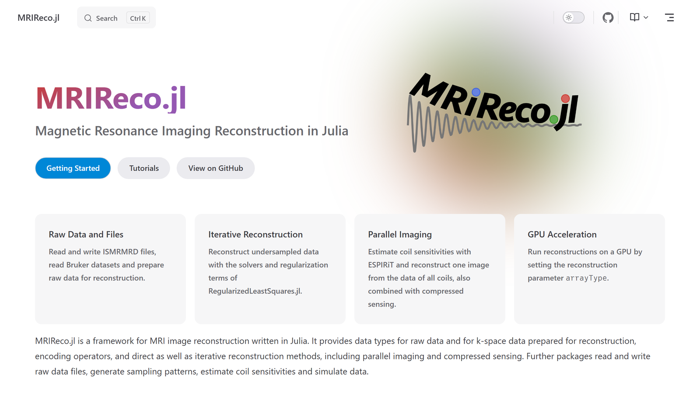

# Hello!

I'm Utku. I was a GSoC 2026 contributor with SciML, and I now help maintain MethodOfLines.jl. This fall, I worked on the [documentation bounty for MRIReco.jl](https://github.com/JuliaHealth/JuliaHealth2026BountyProgram/issues/2) as part of the JuliaHealth 2026 Bounty Program. The goal was to bring the docs up to date, give them a clear structure, and make the subpackages easy to find.

> Have a look at [the new docs](https://magneticresonanceimaging.github.io/MRIReco.jl/dev/).\
> You can find me on [GitHub](https://github.com/utkuyilmaz1903).

Here's a short tour of what changed.

# What is MRIReco.jl?

[MRIReco.jl](https://github.com/MagneticResonanceImaging/MRIReco.jl) is a Julia framework for MRI reconstruction [@Knopp2021MRIReco]. An MRI scanner doesn't measure the image itself, but samples of its Fourier transform, called k-space. Reconstruction turns these samples back into an image, and MRIReco.jl covers the whole way there, from the raw data files of a scanner to direct and iterative reconstructions.

The repository actually holds seven packages, each registered separately. The other six don't depend on MRIReco, so they're useful on their own too.

| Package | Purpose |
|---|---|
| MRIReco | Image reconstruction |
| MRIBase | Data types for raw data, acquisition data and trajectories |
| MRIOperators | Encoding operators |
| MRIFiles | Reading and writing raw data files |
| MRISampling | Undersampling patterns |
| MRICoilSensitivities | Coil sensitivity estimation and coil compression |
| MRISimulation | Simulation of MRI data |

# What Changed

When I started, the docs were one long list of pages, with a single API page for all seven packages. Now they follow Diátaxis [@ProcidaDiataxis], like the docs of KomaMRI and other related packages:

- **Getting Started** covers the installation and a first reconstruction.
- **Tutorials** walk through complete reconstructions, from simple direct reconstructions to multi-coil, multi-echo and subspace reconstructions.
- **How-to guides** each solve one task. They're grouped by topic, so users of MRISampling or MRICoilSensitivities find their guides in one place.
- **Explanations** cover the architecture, the data model, the signal model, reconstruction as an inverse problem, and GPU acceleration.
- **Reference** has an API page for every package and a page on the reconstruction parameters.

The tutorials and almost all how-to guides are Literate.jl scripts that run at every docs build, so a broken example fails the build instead of quietly going out of date. On top of that, the repository got a contributing guide and a code of conduct.

I also moved the docs to VitePress for a fresh look. While switching, I noticed that the images in the docs lost their alt text, so I sent a small fix to DocumenterVitepress.jl.

{fig-alt="Home page of the MRIReco.jl documentation with the title, the buttons Getting Started, Tutorials and View on GitHub, and four cards: Raw Data and Files, Iterative Reconstruction, Parallel Imaging and GPU Acceleration."}

If you want all the details, the documentation pull requests are listed in [this issue](https://github.com/MagneticResonanceImaging/MRIReco.jl/issues/299).

# GPU and Reconstruction Plans

Two topics got extra attention. One was the GPU. The same reconstruction code runs on both the CPU and the GPU, and I wrote a [how-to guide](https://magneticresonanceimaging.github.io/MRIReco.jl/dev/generated/howto/gpu) on using it and an [explanation](https://magneticresonanceimaging.github.io/MRIReco.jl/dev/explanations/gpu) of how it works, drawing on Niklas Hackelberg's [JuliaCon 2026 talk](https://www.youtube.com/watch?v=SsIwveAJOJ4). Moving a reconstruction to the GPU takes one parameter:

```julia
using CUDA
params[:arrayType] = CuArray
image = reconstruction(acqData, params)
```

The other was reconstruction plans. Niklas reworked MRIReco.jl to use AbstractImageReconstruction.jl under the hood, so every reconstruction is now built from a plan with typed parameters. I documented this with a new [reference page](https://magneticresonanceimaging.github.io/MRIReco.jl/dev/reference/parameters) for the parameters and a [how-to guide](https://magneticresonanceimaging.github.io/MRIReco.jl/dev/generated/howto/plans) that shows how to configure a plan, swap out parts of it, and even write a part of your own.

# Bugs Along the Way

Since the examples run at every build and I checked every page against the code, the docs worked a bit like a test suite. While writing them, I kept running into bugs and rough edges. I opened an issue for each one, about 50 in total, and fixed some of them myself, for example in `ExplicitOp` on the GPU, in the `seed` option of the sampling patterns, and in converting `AcquisitionData` back to raw data. The pages link to the open ones where they matter.

# What I Learned

Most of what I learned was about MRI itself. Writing the tutorials made the ideas click for me: why leaving out k-space samples shortens a scan but causes artifacts, how an iterative reconstruction uses prior knowledge about the image to reduce them, and how the different views of several receive coils make up for the missing samples. My favorite was the multi-echo data. The signal decays from echo to echo at a rate that depends on the tissue, so a series of echo images gives you a T2 map. And since a few basis curves describe the decay of all tissues well, a subspace reconstruction only needs a few coefficient maps instead of one image per echo.

I also learned how to write about code that is still changing. The reconstruction interface was reworked while I was working on the docs, so I focused on the parts that would stay.

# What's Next

There's still plenty that could be added. One idea I'd love to see is a tutorial on non-Cartesian data, such as radial or spiral acquisitions. Interactive figures would be fun too, for example for exploring the multi-echo images right in the docs. And some of the issues I opened are still waiting for a fix.

I really enjoyed this project, and I'm looking forward to contributing more to MRIReco.jl and JuliaHealth after the bounty.

# Acknowledgements

First of all, a big thank you to Niklas Hackelberg for reviewing every pull request and for guiding me through the whole project. Aurélien Trotier was a great help on the MRI side, from writing the coil compression guide to sharing the data for the subspace tutorial. Tobias Knopp set up a new home for the docs data on Zenodo and gave useful feedback. And of course, many thanks to Carlos Castillo Passi and JuliaHealth for running the bounty program, and to NumFOCUS for funding it.
